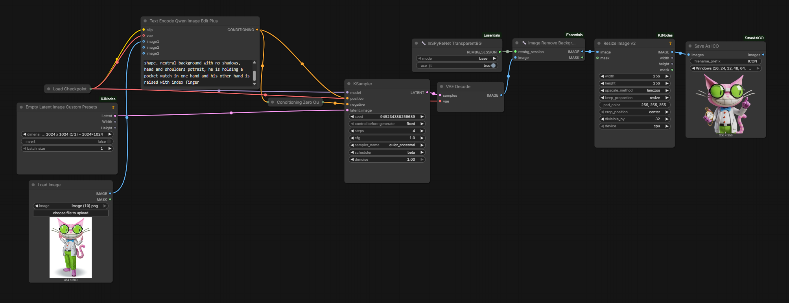

# ComfyUI-SaveAsICO

ComfyUI-SaveAsICO is a simple ComfyUI node which allows you to save generated images as .ICO files.

### Features

 - Saves a multi-size .ICO file with full alpha transparency (frames are stored as PNG, supported since Windows Vista)
 - Offers three size presets:
   - Application: 64, 128, 256
   - Favicon: 16, 32, 48
   - Windows: 16, 24, 32, 48, 64, 128, 256
 - Downscales each smaller size directly from the 256x256 source using Lanczos resampling
 - Saves a 256x256 .PNG next to each .ICO, which is also shown as the node preview
 - Supports batches, saving one .ICO and one .PNG per image
 - Supports the filename prefix tokens `%width%`, `%height%`, `%year%`, `%month%`, `%day%`, `%hour%`, `%minute%`, `%second%`, and `%batch_num%`
 - Passes the input images through to its output for further processing

### Installation

Activate the virtual environment your ComfyUI runs in, then clone the repository into the `custom_nodes` folder and install the requirements:

```
cd ComfyUI/custom_nodes
git clone https://github.com/levicki/ComfyUI-SaveAsICO
pip install -r ComfyUI-SaveAsICO/requirements.txt
```

### Requirements

 - Input image must have alpha transparency
 - Input image must be 256x256 pixels in size

### Example Workflow



### Recommended models

 - Qwen Image 2.1 (by prompting with `This is an RGBA image with transparency. <YOUR PROMPT>. The image has alpha channel and the background is transparent.`)
 - Qwen Image Edit + InSPyReNet TransparentBG + Image Remove Background (both from [ComfyUI-Essentials](https://github.com/comfyorg/comfyui-essentials))
